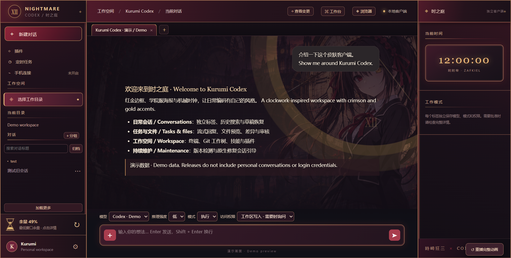

# Kurumi Codex

[简体中文](README.md) · [English](README.en.md) · [Downloads](https://github.com/leihongjin22-ctrl/kurumi-codex/releases/latest)

A Kurumi-themed Codex companion client for Windows x64, featuring a clockwork opening animation, character motion, crimson and gold styling, an illustrated chat background, and everyday coding tools.

**The complete theme runs in this independent desktop client.** The included native Codex plugin provides setup and maintenance skills. It does not replace the native application's entire layout. An optional native color palette is included at `themes/kurumi-theme.txt`.



*The screenshot uses demo data. The application UI is currently primarily Simplified Chinese; documentation is available in Chinese and English.*

## Features

| Area | Included |
| --- | --- |
| Theme and opening | Reversing mechanical clock, character motion, crimson/gold borders, and academy-uniform background artwork |
| Conversations | Independent tabs, per-tab model and access settings, paginated history, search, project grouping, and draft recovery |
| Messages and files | Streaming Markdown, images and attachments, local image/audio/video/text previews, and offline HTML previews |
| Tasks and review | Task progress, reasoning-summary timing, approvals, file diffs, and inline review feedback |
| Workspace | Git worktrees, terminal, skills, plugins, and local scheduled tasks |
| Mobile and usage | Official Remote connection, remote task synchronization, and an hourglass usage-limit indicator |
| Maintenance | Version/protocol checks, update compatibility alerts, prefilled native repair drafts, and a configuration wizard |

## Downloads

| Asset | Recommended use |
| --- | --- |
| [Windows x64 portable client](https://github.com/leihongjin22-ctrl/kurumi-codex/releases/download/v0.9.0/Kurumi-Codex-0.9.0-win-x64.zip) | Recommended for end users; Electron is included |
| [Source and native maintenance plugin](https://github.com/leihongjin22-ctrl/kurumi-codex/releases/download/v0.9.0/Kurumi-Codex-0.9.0-source-plugin.zip) | Inspect the code, build it, or install its maintenance skills |
| [SHA256 checksums](https://github.com/leihongjin22-ctrl/kurumi-codex/releases/download/v0.9.0/SHA256SUMS.txt) | Verify downloaded files |

## Quick start

1. Install native Codex and sign in with your own account. Model access and usage limits come from that account.
2. Extract the **entire** Windows portable ZIP into a writable folder. DSH, Node.js, and npm are not required.
3. Run `Setup.cmd` to create a desktop shortcut and start the client, or use `Launch.cmd` directly.
4. Select your default workspace in the configuration wizard. Codex is detected automatically; custom CLI and Python paths are optional.
5. Open **Kurumi Codex** from your desktop on subsequent runs.

Settings, drafts, recovery state, and logs are stored under the current user's `%APPDATA%\kurumi-codex-client`. They are not included in the downloadable packages. To upgrade, finish or inspect active tasks, close the old client normally, extract the new version, and run its setup. Preserve your AppData profile.

For the source ZIP, run `setup.cmd`. It copies the allowlisted application to `%LOCALAPPDATA%\KurumiCodex\client`, obtains the pinned official Electron runtime, verifies its SHA256, and creates a shortcut. Initial source installation requires internet access.

## Native maintenance plugin

Use **安装原生维护插件 / Install native maintenance plugin** in the configuration wizard, or run:

```powershell
codex plugin marketplace add leihongjin22-ctrl/kurumi-codex
codex plugin add kurumi-skin-tools@kurumi-codex
```

Start a new native Codex conversation to use `kurumi-setup` or `kurumi-repair`. Restart native Codex if the skills do not appear. For a local installation, replace the repository argument with the extracted source directory.

## Compatibility repair after Codex updates

The client tracks verified Codex versions and performs read-only checks. When a version change is associated with a protocol-contract failure, it displays an alert and can open a native Codex conversation containing a repair draft. The draft includes the installation directory, version information, and bounded repair instructions. Automatic handoff occurs once per affected build and can be disabled.

**The prompt is not sent automatically.** Review and send it yourself before repair work begins and uses model quota. Opening a repair conversation does not mean the software has already been fixed. Network, authentication, quota, and missing-conversation failures are classified separately. Existing tasks are not automatically resent or interrupted by the version watcher.

If the native link cannot be opened, you can inspect and copy the draft from the client. The protocol follows the [official new-chat deep-link interface](https://learn.chatgpt.com/docs/reference/commands); plugin layout follows the [official plugin packaging guide](https://developers.openai.com/plugins/build/plugins).

## Optional components

- Mobile Remote requires the same account/workspace and an online computer with the companion client running.
- Document attachments require a Python environment with `requirements-documents.txt`, or existing Codex workspace document components. In an isolated Python environment, run `python -m pip install -r requirements-documents.txt`, then select that environment in the wizard. Scanned-document OCR is not included.
- Git worktree operations require Git. The embedded web browser is separate from native Codex's browser integration.
- Setup and repair respect the current account and approval boundaries. Full filesystem access is not automatically enabled.

## Development and releases

Use Node.js 22 or newer for local logic tests:

```powershell
npm test
powershell.exe -NoProfile -ExecutionPolicy Bypass -File scripts/package-release.ps1
```

The build script verifies the pinned official Electron archive and creates portable and source/plugin ZIPs from an explicit manifest. Put source files in Git and binary ZIPs in GitHub Releases.

The Actions configuration is retained at `.github/workflow-templates/release.yml`. The CLI credential used for the initial publication lacks the `workflow` write scope, so it is provided as a template. Copy it to `.github/workflows/release.yml` using GitHub's website or a credential with the required permission to enable it. Local builds and manual releases remain available. See `docs-public/PUBLISHING.md` and `REPAIR.md`.

## Validation and limitations

Version 0.9.0 has been tested with a relocated Windows x64 portable package, a live app-server connection, source-package tests, isolated native-plugin installation, and conversation regression tests. Distribution files exclude personal sessions, drafts, credentials, configuration, and diagnostic logs.

The repair URL and parameters are tested; visual confirmation of the native application's final composer contents remains unverified. The repair draft cannot guarantee compatibility with every future Codex release. Experimental interfaces may need further adaptation.

## License and attribution

Original code: MIT. See `LICENSE`, `THIRD_PARTY_NOTICES.md`, and `ASSET-NOTICE.md` for third-party components and character-themed artwork. The Windows application has not been signed by this project. Native Codex is not redistributed, and this is not an official OpenAI product.
