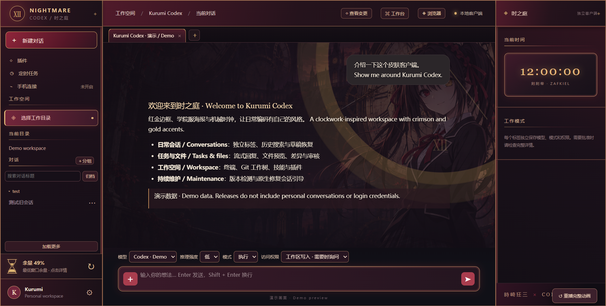

# Kurumi Codex 皮肤套件

[简体中文](README.md) · [English](README.en.md) · [下载 / Downloads](https://github.com/leihongjin22-ctrl/kurumi-codex/releases/latest)

Windows x64 的独立 Codex 主题客户端，包含时钟启动动画、角色动态、红金界面、海报背景、会话标签、文件预览、任务审核、终端、插件与手机连接入口。

**完整皮肤运行在独立客户端中。** 附带的原生 Codex 插件提供安装、配置和兼容维护技能；它不将完整主题布局注入官方窗口。原生配色导入文件另见 `themes/kurumi-theme.txt`。



*截图使用演示数据。当前应用界面主要为简体中文，项目提供中英文说明。*

## 功能

| 模块 | 内容 |
| --- | --- |
| 主题与启动 | 机械时钟倒流、角色动态、红金边框和学院服海报 |
| 会话 | 独立标签、模型与权限设置、历史分页、搜索、项目分组和草稿恢复 |
| 消息与文件 | 流式 Markdown、图片和附件、本地图片/音视频/文本及离线 HTML 预览 |
| 任务与审核 | 执行进度、思考摘要用时、审批、文件差异和行内反馈 |
| 工作区 | Git 工作树、终端、技能、插件与本地定时任务 |
| 手机与额度 | 官方 Remote 接入、远程任务同步、沙漏额度查询 |
| 维护 | 版本与协议诊断、更新故障提示、原生修复会话预填、配置向导 |

## 下载

| 文件 | 适合谁 |
| --- | --- |
| [Windows x64 便携版](https://github.com/leihongjin22-ctrl/kurumi-codex/releases/download/v0.9.0/Kurumi-Codex-0.9.0-win-x64.zip) | 推荐普通用户，含 Electron，完整解压即可配置 |
| [源码 / 原生维护插件](https://github.com/leihongjin22-ctrl/kurumi-codex/releases/download/v0.9.0/Kurumi-Codex-0.9.0-source-plugin.zip) | 希望查看源码、构建或安装维护技能的用户 |
| [SHA256 校验码](https://github.com/leihongjin22-ctrl/kurumi-codex/releases/download/v0.9.0/SHA256SUMS.txt) | 校验下载文件是否完整 |

## 下载后使用

1. 先安装原生 Codex，并登录自己的账户。模型使用自己的账户权限及额度。
2. 推荐下载 Releases 中 `*-win-x64.zip`，完整解压到可写文件夹。它包含 Electron，不需要 DSH、Node.js 或 npm。
3. 双击 `Setup.cmd` 创建桌面入口并启动；也可直接用 `Launch.cmd`。在配置向导中选择工作目录，Codex 默认自动检测；自定义 CLI 路径可选。
4. 之后从桌面 **Kurumi Codex** 打开。日志、会话恢复和配置在当前用户的 `%APPDATA%\kurumi-codex-client`，不在发布包中。

若下载的是 `*-source-plugin.zip`，解压后运行 `setup.cmd`：它将干净客户端复制到 `%LOCALAPPDATA%\KurumiCodex\client`，按 `runtime.json` 下载并验证官方 Electron，创建桌面入口。首次源码安装需要联网。源码用户也可用 Node.js 22 运行本地逻辑测试，不需要安装生产 npm 依赖。

## 原生维护插件

配置向导中可点击“安装原生维护插件”，或在已安装 Codex CLI 的终端执行：

```powershell
codex plugin marketplace add leihongjin22-ctrl/kurumi-codex
codex plugin add kurumi-skin-tools@kurumi-codex
```

在原生 Codex 新会话中使用 `kurumi-setup` 或 `kurumi-repair` 技能。若插件尚未出现在原生界面，重新打开原生 Codex。源码根目录包含 `.codex-plugin/plugin.json` 与 `.agents/plugins/marketplace.json`；本地安装也可将第一个命令的仓库名换成源码目录。

## Codex 更新后的修复引导

客户端保存已验证的 Codex 版本，启动及运行时做只读检查。只有检测到版本变化并出现协议契约不兼容时，才自动提示并通过官方 `codex://new` 链接打开原生新会话，填入本机安装目录、版本及修复要求。每个故障版本自动跳转一次，可在配置中关闭。

提示词不会自动发送。你确认并发送后，原生 Codex 才会执行修复并使用额度。跳转本身不表示修复已完成。网络、登录、额度问题不会触发更新修复；仍可使用诊断页排查。打开失败时可在提示栏查看并复制提示词。客户端不会为更新检测中断正在运行的任务或重发旧消息。

原生新会话预填功能：[官方命令与深层链接文档](https://learn.chatgpt.com/docs/reference/commands)。插件结构：[官方插件打包文档](https://developers.openai.com/plugins/build/plugins)。

## 可选配置

- 手机连接：在左侧启用，需要相同账户和工作区、电脑联网且客户端运行。
- 文档附件：可配置安装了 `requirements-documents.txt` 所列组件的 Python，或使用现有 Codex 工作区文档组件；文本、图片和普通本地文件预览不需要此组件。文档提取不支持扫描件 OCR。
- Git 工作树功能需要本机 Git。内置浏览器与原生浏览器分开。
- 自动配置与修复使用当前系统账户权限和原生 Codex 审批，不自动启用完全访问。
- 如需文档解析，建议在独立 Python 环境中执行 `python -m pip install -r requirements-documents.txt`，再在配置向导中选择该环境的 Python。

## 测试与边界

已验证版本 0.9.0 在本机 Windows x64 上的便携包移位启动、服务连接、源码包测试、原生维护插件安装以及会话功能回归。发布内容使用清单打包，不包含个人会话、草稿、配置、日志或登录凭据。

更新检测和新会话参数已测试，原生输入框中的最终预填效果尚未通过界面自动化实测。修复引导只准备草稿，不能保证未来所有 Codex 更新都能自动修复。较新的实验性接口可能需要适配。完整皮肤保留在独立客户端；原生配色文件提供较轻量的选择。

## 维护与发布

`npm test` 运行不调用模型的逻辑测试；`scripts/package-release.ps1` 从明确清单生成 Windows 便携包与可安装插件源码包。上传 GitHub 应使用源码包内容；便携 ZIP 放入 Releases，避免将运行时二进制提交到源码历史。

GitHub Actions 配置保存在 `.github/workflow-templates/release.yml`。当前发布账号的 CLI 授权没有 `workflow` 写入范围，所以它作为模板保留；使用有相应权限的 GitHub 网页或凭据，将其复制到 `.github/workflows/release.yml` 后可启用。也可始终本地构建、手动发布。详见 `docs-public/PUBLISHING.md` 和 `REPAIR.md`。

代码 MIT；运行时及素材说明见 `THIRD_PARTY_NOTICES.md`、`ASSET-NOTICE.md`。Windows 便携程序未做代码签名。本项目不包含任何人的登录信息、API 密钥或会话数据。
